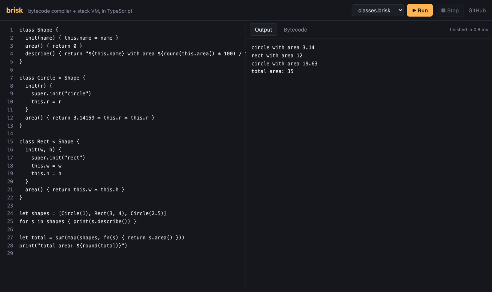
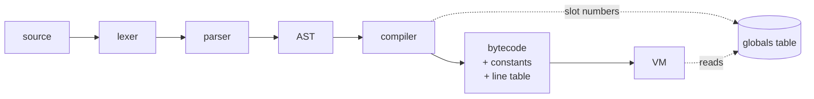
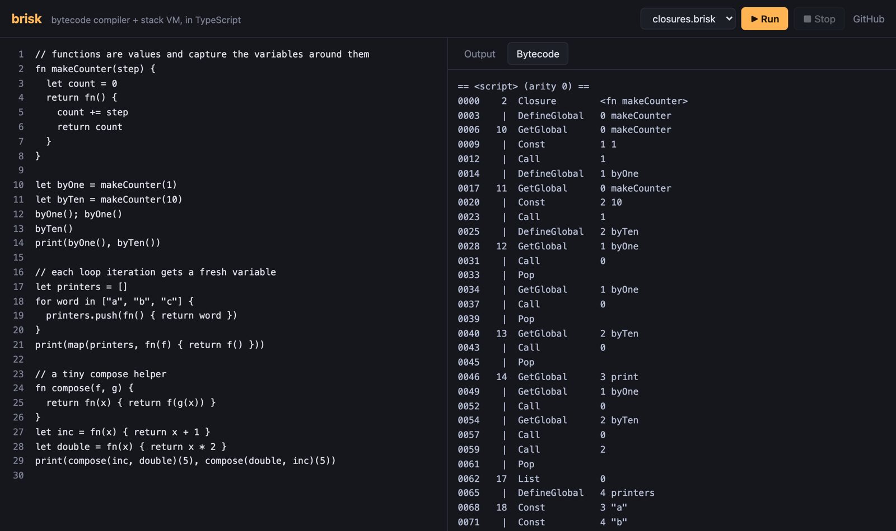

# brisk

[](https://github.com/servanklc93-cmd/brisk/actions/workflows/ci.yml)


A small dynamically typed language with a bytecode compiler and a stack-based virtual machine,
written from scratch in TypeScript. No parser generators, no runtime dependencies.

**[Try it in the browser →](https://servanklc93-cmd.github.io/brisk/)** The playground shows the compiled bytecode live as you type.



```rust
class Shape {
  init(name) { this.name = name }
  describe() { return "${this.name} with area ${this.area()}" }
}

class Rect < Shape {
  init(w, h) {
    super.init("rect")
    this.w = w
    this.h = h
  }
  area() { return this.w * this.h }
}

fn makeCounter() {
  let n = 0
  return fn() { n += 1; return n }
}

let next = makeCounter()
next(); next()
print(Rect(3, 4).describe(), next())   // rect with area 12 3
```

## What's in it

- **Language:** `let`, functions, closures, classes with single inheritance and `super`,
  lists, maps, ranges, `for ... in`, `break` / `continue`, string interpolation that nests
  (`"a ${ "b ${c}" }"`), and newline-terminated statements.
- **Compiler:** a hand-written lexer and recursive descent parser build an AST, and a
  single-pass compiler turns it into bytecode. Along the way it resolves scopes and
  upvalues, folds constants and emits fused instructions for hot patterns.
- **VM:** about 60 opcodes, a value stack, call frames, closures with open/closed upvalues,
  method invocation without allocating bound methods, and copy-down inheritance.
- **Errors:** every error carries a line number. Runtime errors come with a stack trace, and
  the parser recovers after an error so you see all of them at once:

  ```
  runtime error: Can't add nil and number
    1 | fn inner() { return nil + 1 }
    at inner() line 1
    at outer() line 2
    at <script> line 3
  ```
- **Tooling:** a REPL, a file runner, `--disasm` to print bytecode, and the browser playground.

## How it works



**Newlines end statements.** The lexer doesn't emit newline tokens. Instead, every token
records whether a newline came before it. The parser ends a statement at `;`, `}`, EOF or
any token with that flag set. It also uses the flag to tell `f(x)` apart from `f` followed
by `(x)` on the next line, which would otherwise be a call.

**String interpolation in the lexer.** `"a ${x} b"` lexes as `StringHead("a ")`, the
tokens of `x`, then `String(" b")`. The lexer tracks brace depth with a stack, so a `}`
that closes an interpolation resumes the string while a `}` inside a map literal doesn't.

**Closures.** Local variables live in stack slots. When an inner function uses a variable
from an enclosing function, the compiler records an upvalue for it. At runtime an upvalue
first points at the stack slot (*open*). When the variable's scope ends, the VM copies the
value into the upvalue (*closed*), so the closure keeps working after the stack frame is
gone. Open upvalues sit in a list sorted by slot, so two closures over the same variable
share one upvalue and see each other's writes. This is the design from
[Crafting Interpreters](https://craftinginterpreters.com/closures.html).

**Loops capture per iteration.** `for x in xs` gives each iteration its own scope, so
closures created inside the loop capture different variables. JavaScript's `let` in a
`for` loop works the same way.

```
     <xs>; Iter            the iterator lives in a hidden local
top: ForNext it, done      push the next item as the loop variable, or jump out
     <body>
     Pop / CloseUpvalue    end of this iteration's scope
     Loop top
done:
```

**Globals are slots, not names.** The compiler gives every global name a number at compile
time and the VM indexes an array. This was the largest single speedup (see below).

### Making it fast

The first working version was 1.7x to 2.4x *slower* than CPython on three of four
benchmarks. Each change below was measured, and the ones that didn't help were reverted:

| change | why it helps |
|---|---|
| globals resolved to array slots at compile time | one `Map.get(name)` per access was ~30% of a tight loop |
| call frames preallocated and reused | no object allocation per call; the closure check runs first |
| one `case` per opcode instead of shared ones | no second branch on the opcode inside `Lt`/`Le`/`Sub`/`Mul`... |
| `JumpIfNotLt` and friends | `if a < b` takes 1 dispatch instead of 2 |
| `AddLocal` / `AddGlobal` | `total += i` as a statement skips get / add / set / pop |
| ~~instance fields in plain objects~~ | slower: the single `GetProp` site goes megamorphic in V8. Reverted. |

The loop benchmark went from 15 instructions per iteration to 8:

```
0020  GetGlobal   i
0023  Const       10000000
0026  JumpIfNotLt -> 0044
0029  GetGlobal   i
0032  AddGlobal   total
0035  Const       1
0038  AddGlobal   i
0041  Loop        -> 0020
```

Results with `npm run bench` (Node 24 vs CPython 3.12, best of 5, Apple Silicon laptop):

| benchmark | before | after | CPython 3.12 | vs CPython |
|---|---:|---:|---:|---:|
| loop (10M iterations) | 787 ms | 297 ms | 446 ms | 1.5x faster |
| closures (1M created) | 117 ms | 91 ms | 146 ms | 1.6x faster |
| fib(30) | 142 ms | 100 ms | 60 ms | 1.6x slower |
| methods (2M calls) | 190 ms | 171 ms | 110 ms | 1.5x slower |

CPython still wins on calls. 3.12's specializing interpreter avoids most of the per-call
work that brisk does in its `Call` path. That's the next thing to look at.

## Bytecode

`brisk --disasm file.brisk` (or the Bytecode tab in the playground) shows what the compiler
produced, including which variables each closure captures:



## Running it

```bash
npm install
npm run build

node dist/brisk.js                      # REPL
node dist/brisk.js examples/life.brisk  # run a file
node dist/brisk.js --disasm examples/fib.brisk
node dist/brisk.js -e 'print(sum(map(1..11, fn(x) { return x * x })))'
```

## Testing

```bash
npm test          # 56 tests
npm run typecheck
npm run bench
```

- **Golden programs** in [`tests/programs`](tests/programs): each file states its expected
  output in `// expect:` comments (or the error it should fail with), and the runner
  compares exactly. They cover closures, inheritance, loop scoping, the fused instructions
  and every error message.
- **Fuzzing:** 2000 random token sequences go through the whole pipeline, and anything other
  than a clean `CompileError` or `RuntimeError` fails the test. Writing the parser tests also
  turned up a real bug: unterminated input like `let x = (` made the parser recurse until the
  stack overflowed.
- Unit tests for the lexer, parser precedence, constant folding and error formatting.

## Language reference

| | |
|---|---|
| values | numbers (64-bit floats), strings, `true` / `false`, `nil`, lists, maps, ranges, functions, classes, instances |
| truthiness | only `nil` and `false` are falsy. `0` and `""` are truthy |
| operators | `+ - * / %`, `== != < <= > >=`, `and or !`, `..` (range), `= += -= *= /=` |
| strings | `"..."` with escapes and `${expr}` interpolation; `.upper() .lower() .trim() .split() .replace() .slice() .contains() .startsWith() .repeat()` |
| lists | `[1, 2]`, negative indexes, `+` to concatenate; `.push() .pop() .insert() .removeAt() .slice() .reverse() .sort() .join() .contains() .indexOf()` |
| maps | `{"key": value}`, any primitive as a key, missing keys read as `nil`; `.keys() .values() .has() .get(k, default) .remove()` |
| functions | `fn name(a, b) { }`, anonymous `fn(x) { }`, closures, recursion |
| classes | `class B < A { init() { } method() { } }`, `this`, `super.method()` |
| builtins | `print len str num type clock sqrt floor ceil round abs min max random list assert error isInstance` |
| prelude | `map filter reduce sum enumerate`, written in brisk itself ([`src/natives.ts`](src/natives.ts)) |

## Project layout

```
src/
  lexer.ts      tokens, newline tracking, interpolation
  parser.ts     recursive descent parser, error recovery
  ast.ts        node types
  compiler.ts   scopes, upvalues, constant folding, code generation
  chunk.ts      opcodes, bytecode container, disassembler
  globals.ts    global name -> slot table
  vm.ts         the interpreter loop
  value.ts      runtime value types, formatting
  natives.ts    builtins, list/string/map methods, prelude
  cli.ts        REPL and file runner
playground/     browser playground (runs programs in a web worker)
tests/          unit tests, golden programs, fuzz test
bench/          brisk vs CPython benchmarks
```

## Not done yet

- No garbage collector of its own. brisk values are JS objects, so V8's GC handles them.
  A C version would need a mark-sweep collector, which this design leaves room for.
- No modules or imports, no exceptions you can catch, no tail call optimization.
- Error positions are line-based; only lexer and parser errors know the column.

## License

MIT
